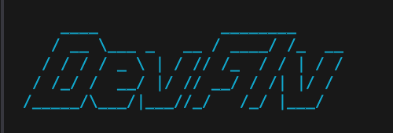

<div align="center">
  
  <p><strong>The open-source autonomous troubleshooter that diagnoses, patches, and verifies broken local development environments.</strong></p>
  
  <p>
    <a href="https://www.npmjs.com/package/devfix"></a>
    <a href="https://devfix.ghulam-mustafa.com"></a>
    <a href="https://github.com/GhulamMustufa/devfix/blob/main/LICENSE"></a>
    
    
  </p>
</div>

---

## 🚨 The Problem: "It Works on My Machine"

Every software engineer and open-source contributor knows the frustration: you clone a repository, run the setup commands, and it fails with a cryptic stack trace. Missing environment variables, mismatched Node or Python versions, conflicting lockfiles, or broken build configurations steal hours of productive time.

Existing AI code assistants fail here because they simply **generate text and guess**. They leave you to copy-paste error messages back and forth in an endless loop.

**DevFix changes that.**

DevFix is an autonomous, sandboxed troubleshooting agent. You point it at a broken project and supply a verification command (`npm test`, `pytest`, `npm run build`). DevFix detects your environment, stages your project safely, launches a hardened Docker container, diagnoses the failure, patches files, and **determines success deterministically using your actual verification commands**.

---

## ✨ Key Capabilities

1. **Deterministic Verification:** Unlike agents that self-declare completion, DevFix relies on objective criteria (process return codes, HTTP responses, or multi-step check pipelines). It iterates until your environment genuinely passes.
2. **Non-Destructive Staging Isolation:** DevFix **never** mounts your real project directory as a writable Docker volume. Repairs happen inside a temporary staging copy. You review a unified diff and must explicitly approve changes before write-back.
3. **Pre-Commit Rollback Protection:** Before touching any file, DevFix saves an immutable rollback snapshot. Reverting any repair is as simple as running `devfix rollback`.
4. **Hardened Docker Sandboxing:** Containers execute as a non-root user (`--user 1000:1000`), drop all kernel capabilities (`--cap-drop=ALL`), disable network by default (`--network=none`), and enforce strict CPU and memory limits.
5. **Deep Environment Detection:** Automatically identifies Node.js (npm, pnpm, yarn, bun, Corepack), Python (pip, uv, Poetry, Pipenv, Conda), version constraints (`.nvmrc`, `engines.node`, `pyproject.toml`), and monorepos (`pnpm-workspace.yaml`, `workspaces` arrays).
6. **Universal Secret Redaction:** Centralized redaction scrubs API keys, bearer tokens, database URLs, and private keys from prompts, logs, and telemetry.
7. **Multi-Provider LLM Engine:** Supports Google Gemini (`gemini-3.8-flash`), DeepSeek, OpenAI (`gpt-4o`), Groq, and keyless local models via Ollama (`llama3.2`).

---

## 🚀 Quick Start

### Installation

Install DevFix globally via npm:

```bash
npm install -g devfix
```

Verify your setup:

```bash
devfix doctor
```

### Configure Your LLM Provider

Add credentials to your `.env` file or export them in your terminal:

```bash
# Google Gemini (Recommended)
export LLM_PROVIDER="gemini"
export GEMINI_API_KEY="AIzaSy..."

# Or DeepSeek
export LLM_PROVIDER="deepseek"
export LLM_API_KEY="sk-..."

# Or Free / Local via Ollama (No API key needed!)
export LLM_PROVIDER="ollama"
```

---

## 🛠️ CLI Usage & Examples

### 1. Inspect a Project (Read-Only)
Analyze a project's language, runtime version, package manager, and configuration conflicts without running any code:

```bash
devfix inspect .
```

To output machine-readable JSON:

```bash
devfix inspect . --json
```

### 2. Repair a Project (`devfix fix`)
Point DevFix at any broken project and specify the command that proves it works:

```bash
# Basic repair with test verification
devfix fix ./my-app --verify "npm test"

# Multi-step verification (build must succeed AND tests must pass)
devfix fix ./my-app --verify "npm run build" --verify "npm test"

# Dry-run mode: diagnose and verify in staging without touching host files
devfix fix ./my-app --verify "npm test" --dry-run

# Allow network access for downloading missing packages
devfix fix ./my-app --verify "npm test" --allow-network

# Non-interactive approval for CI/CD pipelines
devfix fix ./my-app --verify "npm test" --yes

# Specify a custom Docker base image
devfix fix ./backend --verify "pytest" --image python:3.11-slim
```

### 3. Review Diffs & Repair History
```bash
# View recent repairs and rollback availability
devfix history

# Inspect file modifications from previous repairs
devfix diff
```

### 4. Roll Back Changes
Instantly revert any repair to its exact pre-repair state:

```bash
# List available rollback snapshots
devfix rollback --list

# Revert the latest repair
devfix rollback

# Revert a specific repair by ID
devfix rollback devfix-rollback-a1b2c3d4
```

---

## 🔒 Security Model

DevFix is engineered with defense-in-depth security:
- **No Direct Host Mounts:** All repairs run in an isolated temporary staging workspace.
- **Default Network Isolation:** Sandboxes run with `--network=none` by default.
- **Dropped Capabilities:** Full `--cap-drop=ALL` with `--security-opt=no-new-privileges=true`.
- **Sensitive File Exclusion:** `.git`, `.env*` (except `.env.example`), private keys, and cloud credentials are excluded from staging and blocked from tools.
- **Untrusted Data Defense:** All external files and error messages are wrapped in untrusted data prompts to neutralize prompt injection attacks.

For full details, read our [Security Documentation](https://devfix.ghulam-mustafa.com/security).

---

## 📚 Documentation

Comprehensive guides, architecture diagrams, and tutorials are available on our official documentation site:

- 📖 [Official Documentation](https://devfix.ghulam-mustafa.com)
- 🚀 [Quick Start Guide](https://devfix.ghulam-mustafa.com/quickstart)
- ⚙️ [CLI Reference](https://devfix.ghulam-mustafa.com/cli-reference)
- 🏗️ [Architecture Overview](https://devfix.ghulam-mustafa.com/architecture)
- 🛡️ [Security Model](https://devfix.ghulam-mustafa.com/security)
- ❓ [Frequently Asked Questions](https://devfix.ghulam-mustafa.com/faq)
- 📊 [Benchmark Evaluation & Historical Evidence](https://devfix.ghulam-mustafa.com/benchmarks)

---

## 🤝 Contributing

We welcome contributions from the community! Please read [CONTRIBUTING.md](CONTRIBUTING.md) and [AGENTS.md](AGENTS.md) before submitting pull requests.

```bash
# Clone the repository
git clone https://github.com/GhulamMustufa/devfix.git
cd devfix

# Install dependencies
npm install

# Run test suites
npm test

# Build documentation
npm run docs:build
```

---

## 📄 License

DevFix is open-source software released under the [MIT License](LICENSE).  
Copyright © 2024-present Ghulam Mustafa.
